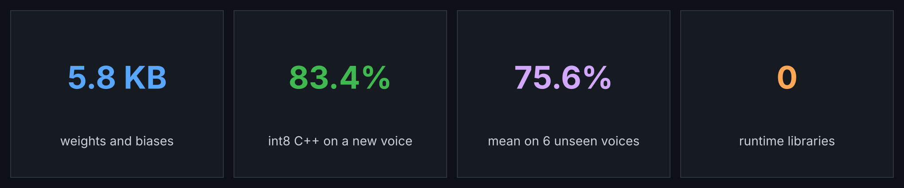
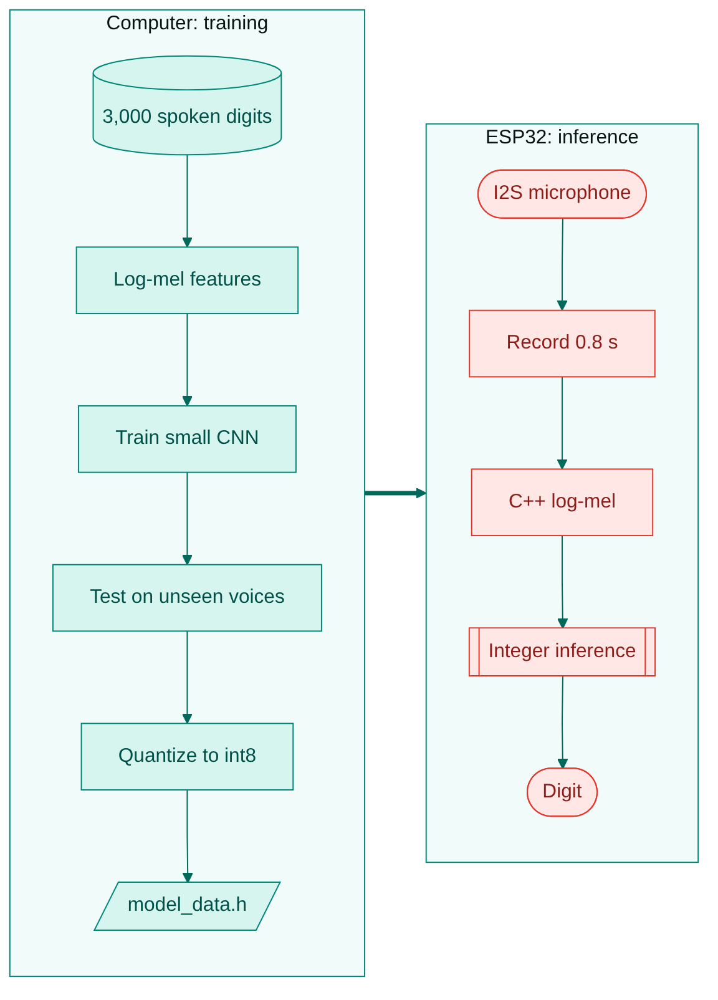
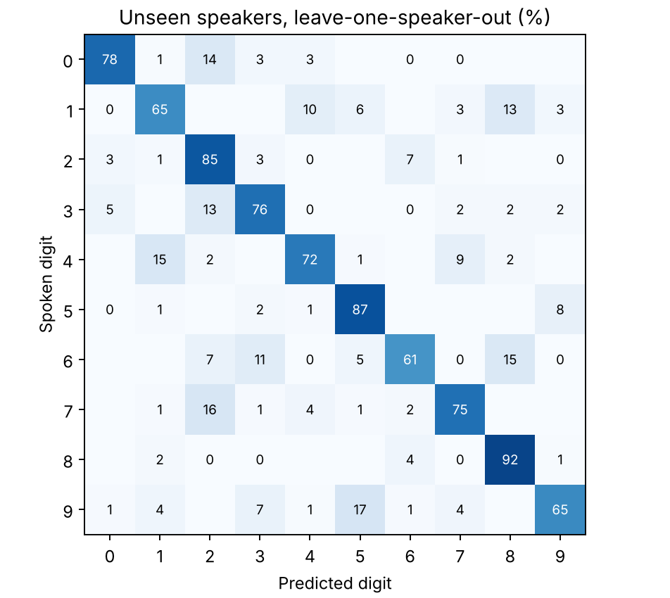
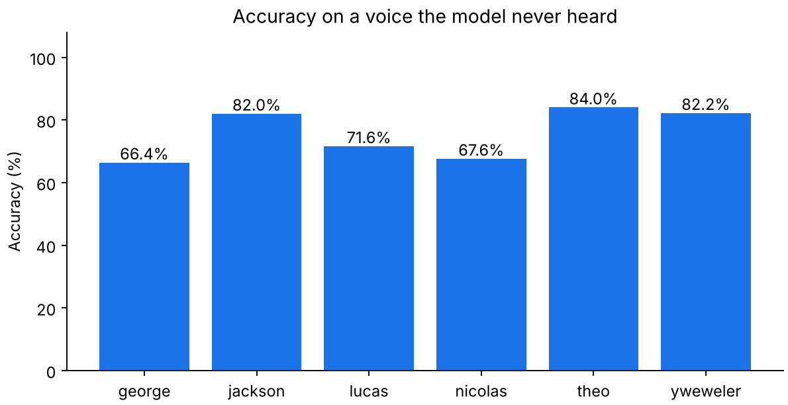
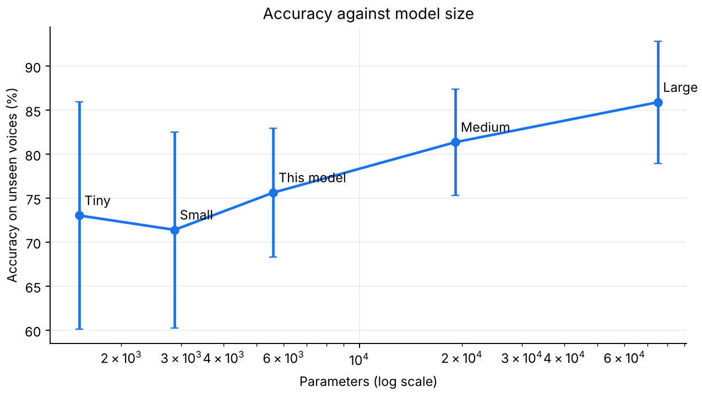
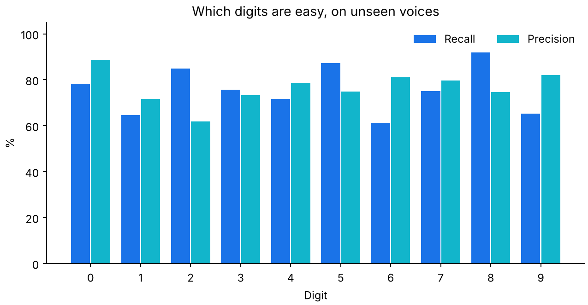
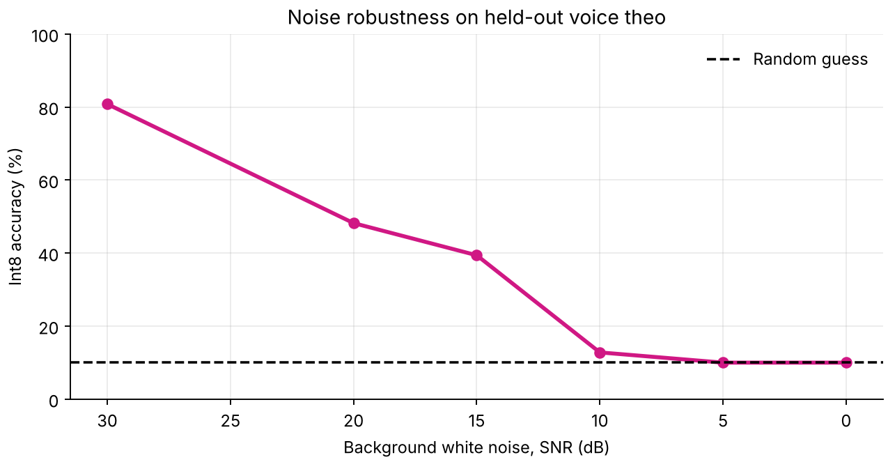
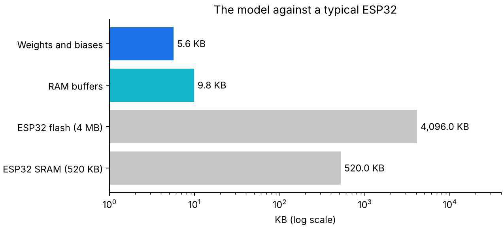
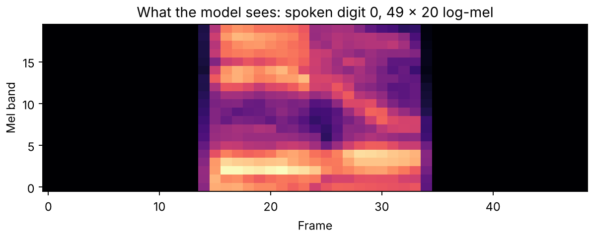
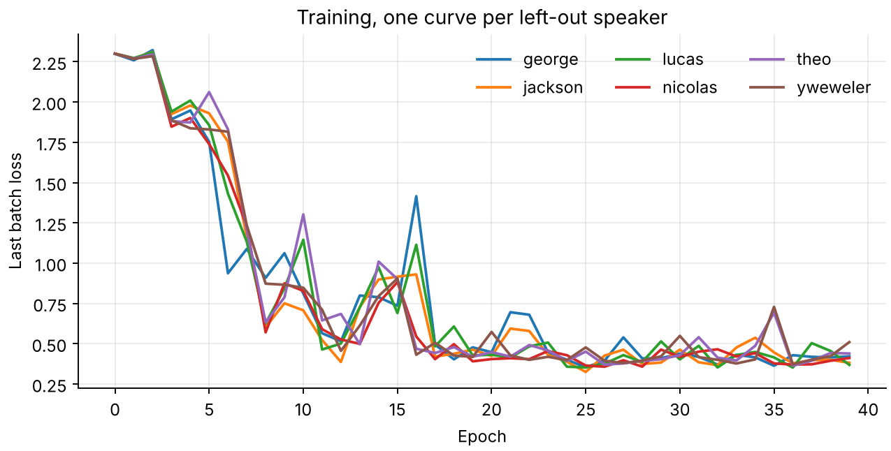

<div align="center">

# TinyML Speech Recognition for ESP32

### Train on real speech, quantize to 8-bit, and export plain C++ with no runtime library




</div>

## Contents

- [Why this project](#why-this-project)
- [Key results](#key-results)
- [Flowchart](#flowchart)
- [Model](#model)
- [Result gallery](#result-gallery)
- [Run it](#run-it)
- [ESP32 wiring](#esp32-wiring)
- [Project layout](#project-layout)
- [Limits](#limits)
- [Next steps](#next-steps)
- [Credits](#credits)

## Why this project

Most TinyML tutorials hide the model behind a large runtime. Here every step is visible, from microphone samples to integer arithmetic. The firmware needs no TensorFlow, no CMSIS and no dynamic memory.

## Key results

The Free Spoken Digit Dataset has 3,000 real recordings of digits 0 to 9 from 6 speakers. Every accuracy below is on a voice the model never heard during training.

| Measure | Result |
|---|---:|
| Mean accuracy, leave one speaker out | **75.6%** |
| Best and worst speaker | 84.0% and 66.4% |
| Held-out voice `theo`, float model | 84.0% |
| Same voice, int8 in Python | 83.4% |
| Same voice, int8 in firmware C++ | **83.4%** |
| Weights and biases | 5,780 bytes |
| Fixed RAM buffers | 10,068 bytes |
| Parameters | 5,594 |
| Features and inference on a PC | 0.62 ms and 0.25 ms |

What this shows:

- Quantization cost only **0.6 percentage points** on the held-out voice.
- The firmware C++ matches the Python integer model, so the export is correct.
- More parameters help: the largest model tested reaches 85.9% with 75,178 parameters.
- **Noise is the weak point.** Accuracy falls from 80.8% at 30 dB SNR to 48.2% at 20 dB, because training used clean audio.

## Flowchart

<p align="center"></p>

## Model

| Layer | Output shape | Parameters |
|---|---:|---:|
| Input log-mel | 1 × 49 × 20 | 0 |
| Conv 3×3, stride 2 | 12 × 25 × 10 | 120 |
| Conv 3×3, stride 2 | 16 × 13 × 5 | 1,744 |
| Conv 3×3, stride 2 | 24 × 7 × 3 | 3,480 |
| Global average pool | 24 | 0 |
| Dense | 10 | 250 |

Quantization uses int8 weights, int32 biases and Q15 multipliers, with the same integer steps in Python and C++.

## Result gallery

### Accuracy

| Confusion matrix | Accuracy per voice |
|---|---|
|  |  |

| Accuracy against model size | Precision and recall per digit |
|---|---|
|  |  |

### Robustness and memory

| Noise robustness | Memory on an ESP32 |
|---|---|
|  |  |

### Signal and training

| Log-mel input | Training curves |
|---|---|
|  |  |

### Model size study

| Model | Channels | Parameters | Accuracy on unseen voices |
|---|---|---:|---:|
| Tiny | 6, 8, 12 | 1,506 | 73.0 ± 12.9% |
| Small | 8, 12, 16 | 2,870 | 71.4 ± 11.1% |
| **This model** | 12, 16, 24 | 5,594 | 75.6 ± 7.3% |
| Medium | 16, 32, 48 | 19,162 | 81.4 ± 6.0% |
| Large | 32, 64, 96 | 75,178 | 85.9 ± 6.9% |

## Run it

```bash
pip install -r requirements.txt
git clone --depth 1 https://github.com/Jakobovski/free-spoken-digit-dataset fsdd

# Training and every experiment, about 6 minutes on a 2-core CPU
python train.py fsdd/recordings

# Run the firmware code on your computer
g++ -O2 -std=c++17 tools/host_test.cpp -o tools/host_test
./tools/host_test
```

## ESP32 wiring

Open `firmware/esp32_kws/esp32_kws.ino` in the Arduino IDE and connect an INMP441 I2S microphone:

| INMP441 | ESP32 |
|---|---|
| SCK | GPIO 26 |
| WS | GPIO 25 |
| SD | GPIO 33 |
| VDD | 3.3 V |
| GND | GND |

## Project layout

```text
features.py                    Log-mel features
train.py                       Training, quantization, experiments, charts
tools/host_test.cpp            Runs the firmware code on a computer
firmware/esp32_kws/
  esp32_kws.ino                Arduino sketch
  tiny_kws.h                   C++ features and integer inference
  model_data.h                 Generated weights
results/                       Charts and JSON numbers
```

## Limits

- **The sketch has not been compiled or run on an ESP32.** The C++ accuracy comes from the same inference and feature code running on a PC.
- Speed on an ESP32 has not been measured.
- The microphone path is untested, and a real microphone will differ from the dataset.
- With 6 speakers, results vary a lot from voice to voice.
- It recognizes one digit per 0.8 s window, with no wake word or streaming detection.

## Next steps

- [ ] Compile and test on a real ESP32 and measure speed
- [ ] Train with background noise
- [ ] Add more speakers and real keywords
- [ ] Add streaming detection

## Credits

Dataset: [Free Spoken Digit Dataset](https://github.com/Jakobovski/free-spoken-digit-dataset), not copied into this repository.

Code by **Jaafar Salim**, University of Technology, Iraq.
